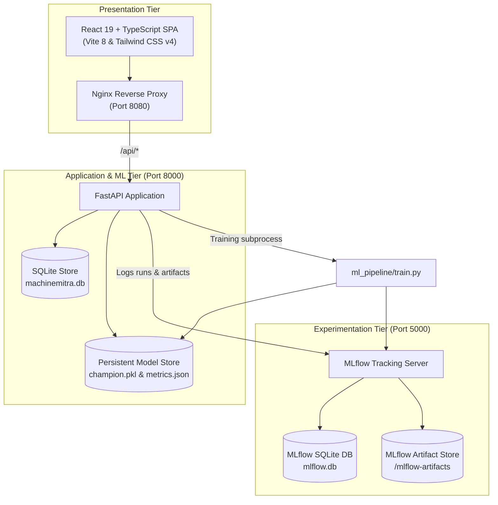
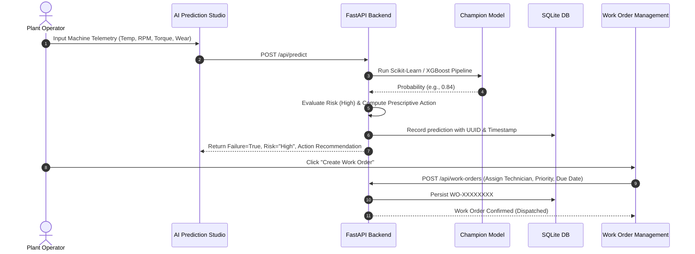

<div align="center">


# MachineMitra (मशीन मित्र)
### Enterprise AI-Powered Predictive Maintenance & MLOps Platform
*“Machine ki sehat, ab AI ki nazar mein!” (Machine Health, Now Under AI Watch!)*

[](https://fastapi.tiangolo.com)
[](https://www.python.org/)
[](https://react.dev/)
[](https://www.typescriptlang.org/)
[](https://tailwindcss.com/)
[](https://mlflow.org/)
[](https://scikit-learn.org/)
[](https://xgboost.ai/)
[](https://www.docker.com/)
[](LICENSE)

<br/>

**MachineMitra** is a full-stack, containerized Industrial AI and MLOps platform engineered to predict equipment breakdowns before they occur, analyze operating risks in real time, and streamline maintenance workflows across factory operations.

</div>

---


## 🌟 Overview & Value Proposition

Unplanned industrial machine downtime costs global manufacturing operations hundreds of billions of dollars annually. Traditional maintenance strategies either react after an expensive failure has occurred (corrective) or follow arbitrary calendar schedules regardless of actual machine wear (preventive).

**MachineMitra** bridges the gap between raw telemetry sensors and real-time maintenance operations:

- **AI-Powered Diagnostics:** Evaluates sensor parameters (temperature, rotational speed, torque, tool wear) against production ML models trained on 10,000 industrial records.
- **Automated Risk Stratification:** Categorizes machine degradation into Low, Medium, and High risk tiers with actionable, rule-based diagnostic guidance.
- **Closed-Loop Maintenance:** Connects predictions directly into work order creation, technician assignment, and status dispatching.
- **Full-Lifecycle MLOps:** Automates training, parameter logging, metric evaluation, model versioning, and champion model deployment using MLflow and FastAPI.

---

## 📸 Application Showcase

### 1. Plant & Fleet Overview Dashboard

The **Overview Dashboard** serves as the central command center for plant managers and reliability engineers, providing a comprehensive high-level view of fleet health, active alarms, and critical assets.

<div align="center">
  
  <p><em>Figure 1: MachineMitra Executive Overview Dashboard showing aggregate fleet health, condition distribution, critical priority assets, and active telemetry alarms.</em></p>
</div>

#### Key Dashboard Capabilities Visible Above:
- **Personalized Header & Multi-Plant Navigation:** Displays the plant manager profile (`Namaste, Prince`), active facility context (`Pune Plant`), system alert notifications, and the platform tagline.
- **Fleet Operational KPI Cards:**
  - **Total Machines (10):** Fleet visibility tracking online connectivity (9 currently operational, 1 offline).
  - **Fleet Health Score (81%):** Continuous composite health index calculated across live machine telemetry.
  - **Active Alerts (2):** Real-time warnings generated when machine sensor readings breach safe operating envelopes (1 requiring immediate intervention).
  - **Maintenance Due (2):** Scheduled preventive maintenance work orders pending execution.
- **7-Day Fleet Health Trend Chart:** Interactive time-series visual tracking daily fleet health stability (trending at `81` with a `+3.1 pts` improvement trajectory).
- **Health Distribution Donut Chart:** Instant categorical fleet condition breakdown:
  - 🟢 **Healthy (6 Machines):** Operating within nominal tolerances.
  - 🟡 **Attention (2 Machines):** Mild sensor anomalies or elevated tool wear.
  - 🔴 **Critical (1 Machine):** Imminent failure hazard requiring immediate inspection.
  - ⚪ **Offline (1 Machine):** De-energized or undergoing planned overhaul.
- **Priority Machines Action List:** Ranked roster of vulnerable assets sorted by urgency (e.g., *Steam Boiler 02* at 52% Offline, *Conveyor Motor 18* at 64% Critical, *Coolant Pump 09* at 75% Attention) with one-click drill-down to telemetry history.
- **Recent Alerts Stream:** Live operational feed categorizing real-time telemetry violations by severity (High: *Motor current above threshold*, Medium: *Temperature anomaly detected*, Low: *Pressure trend stabilized*).

---

### 2. AI Failure Prediction & Diagnostic Studio

The **AI Failure Prediction Studio** provides engineers and operators with an interactive workspace to evaluate live machine conditions against the production-registered champion ML model.

<div align="center">
  
  <p><em>Figure 2: MachineMitra AI Failure Prediction Studio with real-time sensor parameter inputs, model status verification, and operational risk threshold guidance.</em></p>
</div>

#### Key Prediction Studio Capabilities Visible Above:
- **Live Production Model Binding:** Directly interfaces with the champion model trained and versioned in MLflow (`champion.pkl`).
- **Interactive Sensor Parameters Form:**
  - **Machine ID Selector:** Choose an existing asset from the connected fleet to automatically load its latest telemetry, or test unlisted equipment.
  - **Product Type ($L$, $M$, $H$):** Selects the variant quality grade (Low 50%, Medium 30%, High 20%), which directly influences mechanical stress limits.
  - **Air Temperature [K]:** Ambient operating environment temperature (nominal ~298 K / 25°C).
  - **Process Temperature [K]:** Thermal dissipation temperature generated by the industrial process (nominal ~308 K / 35°C).
  - **Rotational Speed [RPM]:** Shaft velocity measured at the spindle (validated between 100 and 10,000 RPM).
  - **Torque [Nm]:** Output torque delivered by the motor, indicating mechanical loading and resistance (nominal ~40 Nm).
  - **Tool Wear [min]:** Cumulative runtime minutes on the cutting/grinding tool (identifies degradation beyond safe thresholds).
- **Control Actions:**
  - **Load Sample Data:** Instantly populates stressed sensor combinations (e.g., tool wear > 200 min, elevated torque) for rapid validation.
  - **Reset:** Restores default baseline operating conditions.
  - **Predict Failure:** Dispatches a validated POST request to `/api/predict` to trigger low-latency inference.
- **Operational Guidance & Risk Thresholds Matrix:**
  - 🟢 **Low Risk ($< 30\%$):** Normal operation; maintain scheduled inspections and monitor sensor baselines.
  - 🟡 **Medium Risk ($30.00\% - 69.99\%$):** Schedule maintenance inspection focusing specifically on anomalous sensors (tool wear, torque, or thermal delta).
  - 🔴 **High Risk ($\ge 70.00\%$):** Urgent shutdown/isolation protocol. De-energize and inspect before catastrophic breakdown.
  - **$F_2$-Validated Binary Threshold:** Independent classification boundary tuned to heavily penalize false negatives (missed failures).

---

## 🏛 System Architecture

MachineMitra is structured as a decoupled, microservices-based system running in Docker containers connected via a private bridge network:



### Component Responsibilities:
1. **Frontend Service (`frontend`):** Built with React 19, TypeScript, and Tailwind CSS v4, compiled and served through a lightweight Alpine Nginx container. Features interactive Recharts analytics, real-time KPI aggregations, and responsive layouts.
2. **Backend Service (`backend`):** FastAPI asynchronous web server exposing REST endpoints for health checks, model inference, background training jobs, prediction histories, and work orders.
3. **MLflow Tracking Server (`mlflow`):** Dedicated experiment tracking server storing parameters, evaluation metrics (PR-AUC, ROC-AUC, $F_1$, $F_2$, Recall, Precision), and model artifacts with SQLite backend storage.

---

## 🔬 End-to-End MLOps Pipeline

### Dataset & Feature Engineering
MachineMitra is built on the benchmark **AI4I 2020 Predictive Maintenance Dataset** (UC Irvine Machine Learning Repository), comprising 10,000 synthetic records reflecting real industrial milling machine telemetry.

```text
Features Used for Prediction:
├── Type                     -> Categorical (L: 50%, M: 30%, H: 20%)
├── Air temperature [K]      -> Continuous (Ambient temperature ~300 K)
├── Process temperature [K]  -> Continuous (Machine process temperature ~310 K)
├── Rotational speed [rpm]   -> Continuous (Calculated from electrical power ~1500 rpm)
├── Torque [Nm]              -> Continuous (Normally distributed around 40 Nm)
└── Tool wear [min]          -> Continuous (Tool usage duration, failure > 200 min)
```

The preprocessing pipeline is constructed using Scikit-Learn `ColumnTransformer`:
- **Categorical (`Type`):** Processed via `OneHotEncoder(handle_unknown='ignore')`.
- **Numeric Features:** Imputed with `SimpleImputer(strategy='median')` and normalized via `StandardScaler()`.

### Data Leakage Prevention
To ensure valid generalization and prevent synthetic leakage, the following attributes are **strictly excluded** from training:
- **`UDI` & `Product ID`:** Arbitrary sequence identifiers that carry no physical sensor signal.
- **Specific Failure Mode Columns (`TWF`, `HDF`, `PWF`, `OSF`, `RNF`):** Tool Wear Failure, Heat Dissipation Failure, Power Failure, Overstrain Failure, and Random Failure directly leak the target label (`Machine failure`) and are never present during inference.

### Stratified Splitting & Imbalance Handling
The dataset exhibits extreme class imbalance (~3.39% failure rate; 339 positive cases vs 9,661 negative cases).
- **Data Splitting:** Stratified three-way split ensuring identical class proportions across partitions:
  - **Training Split (70%):** Model fitting.
  - **Validation Split (15%):** Hyperparameter tuning, candidate model comparison, and threshold selection.
  - **Test Split (Held-Out 15%):** Final unbiased champion evaluation.
- **Imbalance Mitigation:**
  - **Random Forest:** Configured with `class_weight='balanced_subsample'`, adjusting weights inversely proportional to class frequencies within each bootstrap tree.
  - **XGBoost:** Configured with `scale_pos_weight = neg_samples / pos_samples` (approx. 28.5x weight penalty for positive errors).

### Model Competition & Champion Selection
Two distinct ensemble algorithms compete in each training run:

| Hyperparameter / Feature | Random Forest Classifier | XGBoost Classifier |
|---|---|---|
| **Estimators** | 350 trees | 350 boosted trees |
| **Tree Depth** | Unconstrained (`max_depth=None`) | Constrained (`max_depth=5`) |
| **Regularization** | `min_samples_leaf=2` | `reg_lambda=2.0`, `colsample_bytree=0.85` |
| **Learning Rate** | N/A (Bagging) | `learning_rate=0.05` |
| **Imbalance Handling** | `class_weight='balanced_subsample'` | `scale_pos_weight=weight` |
| **Primary Metric** | Validation PR-AUC | Validation PR-AUC |
| **Secondary Metric** | Validation Recall | Validation Recall |

> [!IMPORTANT]
> **Why PR-AUC Over Accuracy or ROC-AUC?**
> In heavily imbalanced industrial datasets, high accuracy is deceptive (a dummy model predicting all negatives achieves 96.6% accuracy but catches 0 failures). ROC-AUC can also remain optimistically inflated due to the overwhelming number of true negatives. **Precision-Recall AUC (PR-AUC)** focuses specifically on minority class detection performance.

### F2-Score Optimal Thresholding
Default classification thresholds (0.5) are sub-optimal in predictive maintenance where **missing an impending failure (False Negative)** leads to catastrophic downtime, while a **false inspection alarm (False Positive)** merely costs minor technician inspection time.

The binary decision threshold $\theta^*$ is dynamically optimized on the validation set using the $F_2$-Score ($\beta=2$):

$$F_2 = \frac{5 \cdot \text{Precision} \cdot \text{Recall}}{4 \cdot \text{Precision} + \text{Recall}}$$

The threshold yielding maximum validation $F_2$ is serialized alongside the model pipeline in `champion.pkl`.

### MLflow Experiment Tracking
Every training execution logs runs under the experiment `MachineMitra Predictive Maintenance`:
- **Parameters:** Model family, random seed, training/validation/test sample counts, selection criteria.
- **Metrics:** Validation & test Accuracy, Precision, Recall, $F_1$, $F_2$, PR-AUC, ROC-AUC, training duration (seconds).
- **Artifacts:** Full Scikit-Learn / XGBoost pipeline bundles and confusion matrix records.

---

## 🛠 Fleet Operations & Maintenance Workflows

MachineMitra does not stop at model inference—it closes the loop with operational plant maintenance:



### Action Recommendation Engine
Depending on the calculated probability and specific sensor readings, the system generates rule-based operational instructions:
- **High Risk ($\ge 70\%$):** *"Urgent inspection: stop or safely isolate the machine if operating conditions are abnormal. Inspect temperature, torque, tool wear and lubrication before restart."*
- **Medium Risk ($30\% - 69\%$):** Dynamically isolates anomalous drivers:
  - If Tool Wear $\ge 150\text{ min}$: Flags tool wear inspection.
  - If Torque $\ge 50\text{ Nm}$: Flags mechanical drive and gearbox checks.
  - If Air Temp $\ge 303\text{ K}$: Flags thermal heat dissipation inspection.
- **Low Risk ($< 30\%$):** *"Continue normal operation. Maintain routine inspections and monitor sensor trends for changes."*

---

## 💻 Technology Stack

| Domain | Layer / Tool | Version | Purpose |
|---|---|---|---|
| **Frontend** | React | 19.0.0 | Component-driven user interface |
| | TypeScript | 5.7.2 | Type-safe state and data contracts |
| | Vite | 8.0.0 | Next-generation bundler and hot reload engine |
| | Tailwind CSS | 4.0.0 | Modern utility-first styling architecture |
| | Recharts | 2.15.0 | Data visualizations and fleet telemetry charts |
| | Lucide React | 1.16.0 | Clean industrial UI iconography |
| **Backend** | FastAPI | 0.115+ | High-throughput asynchronous Python web framework |
| | Uvicorn | 0.32+ | Production ASGI server implementation |
| | Pydantic | 2.9+ | Request and response schema validation |
| | SQLite | 3 | Embedded database for predictions & work orders |
| **Machine Learning** | Scikit-Learn | 1.4+ | Random Forest, preprocessing pipelines, metrics |
| | XGBoost | 2.0+ | Extreme Gradient Boosting classifier |
| | Pandas & NumPy | 2.2+ | Data manipulation and numerical operations |
| **MLOps** | MLflow | 2.22.0 | Experiment tracking, model registry, artifact storage |
| **Deployment** | Docker & Compose | v2+ | Multi-container orchestration |
| | Nginx | Alpine | Static production frontend asset web server |

---

## 🚀 Quickstart with Docker Compose

Running the entire platform (Frontend, Backend, and MLflow) requires only Docker Desktop.

### 1. Prerequisites
- **Operating System:** Windows 10/11, macOS, or Linux
- **Docker Desktop:** Installed and running (WSL 2 backend enabled on Windows)
- **RAM:** Minimum 8 GB recommended

### 2. Clone the Repository
```powershell
git clone https://github.com/saqibkhan1691/machinemitra-predictive-maintenance.git
cd machinemitra-predictive-maintenance
```

### 3. Build & Launch Containers
```powershell
docker compose up --build -d
```

Docker Compose spins up three interconnected services:
1. `backend` initializes database tables, health checks, and mounts persistent volumes.
2. `mlflow` launches the MLflow tracking server on port `5000`.
3. `frontend` builds production assets and serves them via Nginx on port `8080`.

### 4. Access the Services

| Service | Access URL | Credentials / Notes |
|---|---|---|
| **MachineMitra Web Dashboard** | [http://localhost:8080](http://localhost:8080) | Demo login available on screen |
| **Backend Swagger API Docs** | [http://localhost:8000/docs](http://localhost:8000/docs) | Interactive OpenAPI interface |
| **Backend Health Check** | [http://localhost:8000/api/health](http://localhost:8000/api/health) | JSON service & model health status |
| **MLflow Experiment Tracking** | [http://localhost:5000](http://localhost:5000) | Full tracking dashboard & artifacts |

### 5. Docker Lifecycle Commands
```powershell
# Check status of running containers
docker compose ps

# Follow logs from backend
docker compose logs -f backend

# Follow logs from MLflow
docker compose logs -f mlflow

# Stop containers safely (preserves database and models)
docker compose down

# Stop containers and reset all volumes (erases database and saved models)
docker compose down -v
```

---

## 💻 Local Development Setup (Without Docker)

You can run both frontend and backend locally on your host machine for development.

### 1. Backend & ML Pipeline Setup
- **Python Version:** 3.11 recommended.

```powershell
# Create and activate a virtual environment
python -m venv .venv
.\.venv\Scripts\Activate.ps1   # On Windows
# source .venv/bin/activate    # On Linux/macOS

# Install dependencies
pip install -r backend/requirements.txt

# Run initial model training to generate models/champion.pkl
python ml_pipeline/train.py

# Start FastAPI server on port 8000
uvicorn backend.app.main:app --host 0.0.0.0 --port 8000 --reload
```

### 2. Frontend Setup
- **Node.js:** v18+ or v20+

```powershell
# Install Node dependencies
npm install

# Start Vite development server
npm run dev
```
The frontend will start at `http://localhost:5173` (or `http://localhost:8443` inside Figma Make environments).

---

## 📡 REST API Reference

The FastAPI backend exposes the following core endpoints:

### Prediction & Telemetry

#### `POST /api/predict`
Executes real-time machine failure prediction using the champion pipeline.

**Request Payload:**
```json
{
  "machineId": "MM-CNV-018",
  "productType": "M",
  "airTemperature": 298.0,
  "processTemperature": 308.0,
  "rotationalSpeed": 1500.0,
  "torque": 40.0,
  "toolWear": 60.0
}
```

**Response Payload (200 OK):**
```json
{
  "id": "e308b261-2401-4be5-a4f6-829d7847ea63",
  "machineId": "MM-CNV-018",
  "timestamp": "2026-11-20T01:15:30.123456Z",
  "probability": 0.041285,
  "failure": false,
  "risk": "Low",
  "action": "Continue normal operation. Maintain routine inspections and monitor sensor trends for changes.",
  "sensors": {
    "airTemperature": 298.0,
    "processTemperature": 308.0,
    "rotationalSpeed": 1500.0,
    "torque": 40.0,
    "toolWear": 60.0
  },
  "model": "XGBoost",
  "version": "1",
  "saved": true
}
```

#### `GET /api/predictions?limit=100`
Returns historical prediction records stored in SQLite, ordered by descending timestamp.

---

### Model Management & Training

#### `POST /api/train`
Dispatches an asynchronous background task to train Random Forest and XGBoost models, evaluate validation metrics, optimize the $F_2$ threshold, register experiments in MLflow, and export the champion.

#### `GET /api/train/status`
Returns current execution status of the background training job (`not_started`, `queued`, `running`, `completed`, `failed`).

#### `GET /api/model/status`
Returns information regarding the currently loaded champion model (`trained`, `model`, `version`, `threshold`).

#### `GET /api/model/metrics`
Returns detailed validation and test evaluation metrics for all trained models.

---

### Operations & Work Orders

#### `GET /api/work-orders`
Retrieves all open and historical maintenance work orders.

#### `POST /api/work-orders`
Creates and dispatches a maintenance work order linked to an asset.

**Request Payload:**
```json
{
  "machineId": "MM-CNV-018",
  "title": "Inspect Conveyor Motor Overheating",
  "priority": "High",
  "status": "Pending",
  "technician": "Rahul Verma",
  "dueDate": "2026-11-22"
}
```

#### `PATCH /api/work-orders/{work_id}?status=Completed`
Updates the operational status of an existing work order (`Pending`, `In Progress`, `Completed`, `Cancelled`).

---

### System & Health

#### `GET /api/health`
```json
{
  "status": "healthy",
  "service": "machinemitra-api",
  "model_loaded": true,
  "mlflow_tracking_uri": "http://mlflow:5000"
}
```

#### `GET /api/monitoring/summary`
Calculates recent prediction distribution, high-risk ratios, and flags whether sufficient production inference volume exists for statistical drift detection.

---

## ⚠️ Implementation Boundaries & Roadmap

MachineMitra was developed as an academic and engineering demonstration of applied industrial MLOps. When considering production deployment, take note of the following:

1. **Authentication & Identity:** The current login interface operates as a local prototype gate. Production deployments should implement OAuth 2.0 / OIDC (e.g., Keycloak, Auth0, or Azure AD) with Role-Based Access Control (RBAC).
2. **Streaming Ingestion:** Telemetry is currently ingested via batch REST requests and demo simulation. Integration with Apache Kafka or MQTT brokers (e.g., Eclipse Mosquitto) is planned for continuous factory sensor streams.
3. **Data Drift Detection:** A drift summary stub is included (`/api/monitoring/summary`). Full statistical drift calculation (e.g., Kolmogorov-Smirnov test or Evidently AI) requires a permanent baseline feature store.
4. **Data Ingestion Retraining Loop:** Uploaded CSV files via `/api/data/upload` are staged in `incoming/`. Automated retraining triggers should include schema validation and human-in-the-loop review before entering the training corpus.

---

## 🔄 Model-Quality Monitoring & Retraining Pipeline (MLOps Capability)

MachineMitra includes an automated model monitoring, retraining, and quality-gated deployment capability to maintain prediction reliability as new plant telemetry arrives.

### 5-Stage Assessment Workflow

1. **Task A — Ingest & Validate New Batch (`ml_pipeline/data_validation.py`):**
   - Ingests `data/incoming/new_batch_dataset.csv` (10,000 records).
   - Validates schema against 6 required features (`Type`, `Air temperature [K]`, `Process temperature [K]`, `Rotational speed [rpm]`, `Torque [Nm]`, `Tool wear [min]`).
   - Detects new sensor channels (`Vibration [mm/s]`, `Humidity [%]`).
   - Audits missing values (0 nulls) and duplicate records (0 duplicates).
   - Reports class imbalance ratio (28.5:1, 96.61% normal vs 3.39% failure).
   - Produces `reports/data_validation_report.json`.

2. **Task B — Evaluate Existing Model (`ml_pipeline/evaluate_model.py`):**
   - Evaluates production Champion (`models/champion.pkl`, XGBoost v1 at threshold `0.3088`).
   - Computes: Accuracy (96.64%), Precision (50.28%), Recall (80.83%), F1-Score (61.99%), PR-AUC (0.7324), ROC-AUC (0.9785).
   - Intercepts 274 of 339 breakdowns; misses 65 breakdowns.
   - Produces `reports/model_evaluation_report.json`.

3. **Task C — Retrain Candidate Model (`ml_pipeline/retrain.py`):**
   - Synthesizes 20,000 samples (`data/baseline/baseline_dataset.csv` 10k + `data/incoming/new_batch_dataset.csv` 10k).
   - Trains Candidate XGBoost with `scale_pos_weight=28.5` and $F_2$-score threshold optimization (`0.5022`).
   - Logs metrics, parameters, and pipeline artifact to MLflow (`Candidate Retraining (Combined Data)`).
   - Saves candidate artifact separately to `models/candidate.pkl` without overwriting champion.

4. **Task D — Automated Quality Gate (`ml_pipeline/quality_gate.py`):**
   - Compares Candidate vs Champion on identical evaluation data.
   - **Metric Justification:** Recall and F1-Score are prioritized over Accuracy because undetected breakdowns (False Negatives) cause costly downtime, while naive zero-rule models achieve 96.6% accuracy with 0% recall.
   - Decision Rules: Candidate Recall >= Champion Recall - 0.01; Candidate F1 >= Champion F1.
   - Result: `ELIGIBLE_FOR_PROMOTION` (Recall +15.04% to 95.87%, F1 +11.29% to 73.28%, reducing missed breakdowns from 65 to 14).
   - Overwrite Safeguard: Champion is preserved (`CHAMPION_RETAINED`) unless `--promote` is explicitly supplied. Produces `reports/quality_gate_decision.json`.

5. **Task E — Execution & Orchestration:**
   - Run full pipeline:
     ```cmd
     scripts\run_monitoring.bat
     # OR
     python ml_pipeline/run_monitoring_pipeline.py
     ```
   - Run Pytest test suite:
     ```powershell
     pytest backend/tests -v
     ```

---

## 📜 License & Acknowledgements

- **Dataset:** [AI4I 2020 Predictive Maintenance Dataset](https://archive.ics.uci.edu/dataset/601/ai4i+2020+predictive+maintenance+dataset), licensed under Creative Commons Attribution 4.0 International (CC BY 4.0). Mathes, Stephan (2020).
- **Core Libraries:** Developed with open-source tools including [FastAPI](https://fastapi.tiangolo.com/), [MLflow](https://mlflow.org/), [Scikit-Learn](https://scikit-learn.org/), [XGBoost](https://xgboost.ai/), [React](https://react.dev/), [Vite](https://vite.dev/), and [Tailwind CSS](https://tailwindcss.com/).

---

<div align="center">
  <sub>Built with ❤️ for modern industrial intelligence and reliable plant engineering.</sub><br/>
  <strong>MachineMitra &copy; 2026</strong>
</div>


develpoed inside kiet group of Institution with training purpose in xebia
and ci works fine with v4
