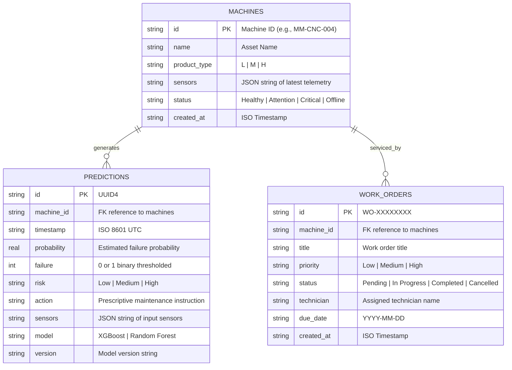

# MachineMitra — Phase 8 & 9: Dashboard UI & Database Architecture

## 1. Database Architecture & SQLite Schema (`backend/app/db.py`)

MachineMitra utilizes **SQLite 3** (`data/machinemitra.db`) as its persistence engine.

### Table Details
1. **`predictions`**:
   - Primary Key: `id` (UUID4).
   - Written: Inside `predict()` in `backend/app/main.py` whenever a prediction is generated.
   - Retrieved: By `GET /api/predictions` and aggregated by `GET /api/monitoring/summary`.
2. **`work_orders`**:
   - Primary Key: `id` (`WO-` + 8 hex chars).
   - Created: By `POST /api/work-orders` (linked to high-risk machine alerts).
   - Updated: By `PATCH /api/work-orders/{work_id}?status=Completed`.
3. **`machines`**:
   - Primary Key: `id` (e.g., `MM-CNC-004`).
   - Stores asset identity, variant grade, latest telemetry snapshot, and health state.

---

## 2. Frontend Page-by-Page Audit (`src/pages/`)

| Page Component | Primary Purpose | Key Visual Elements | Data Source & Nature |
|---|---|---|---|
| **`Overview.tsx`** | Plant executive command center | Fleet health score (81%), active alarms (2), maintenance due (2), 7-day health trend chart, condition distribution donut. | **Calculated & Seeded:** Aggregated from `AppData` context (`src/data/seed.ts`), dynamic Recharts time-series. |
| **`Prediction.tsx`** | AI Failure Diagnostic Studio | Machine selector, sensor parameter number fields (Air Temp, Process Temp, RPM, Torque, Tool Wear), Load Sample button. | **User-Driven:** Submits POST request to `/api/predict` via `src/services/mockApi.ts`. |
| **`PredictionResult.tsx`** | Detailed diagnostic report | Big decision badge (YES/NO), probability gauge, risk tier, prescriptive action, sensor snapshot, Create Work Order button. | **Model-Generated:** Dynamic state returned directly from backend FastAPI inference. |
| **`PredictionHistory.tsx`** | Historical prediction audit log | Filterable, searchable table with pagination, CSV export button. | **Database-Driven:** Queries stored prediction records. |
| **`ModelPerformance.tsx`** | MLOps model comparison studio | Champion model badge, validation metric comparison bar chart (PR-AUC, Recall, F1), training duration, MLflow link, Train Models button. | **MLOps & Backend:** Fetches `/api/model/metrics` and polls `/api/train/status`. |
| **`Monitoring.tsx`** | Telemetry and drift dashboard | Live prediction count, model health status, data drift status, simulated volume area chart, Trigger Retraining button. | **Backend Monitoring:** Hits `/api/monitoring/summary` to fetch real database prediction statistics. |
| **`WorkOrders.tsx`** | Maintenance operations board | Searchable, filterable work order table, priority badges, status dropdowns, Create/Edit modals. | **Operational State:** Managed via `AppDataProvider` (`localStorage`). |
| **`Machines.tsx` & `MachineDetail.tsx`** | Fleet asset catalog & telemetry history | Machine grid, health scores, live sensor gauges, 24h historical temperature/torque trend lines. | **Telemetry State:** Visualizes connected factory assets and sensor history. |
| **`Reports.tsx`** | Operational reporting suite | Date range selectors, preview table, CSV and TXT download generators. | **Client-Generated:** Formats and exports data blobs for plant maintenance logs. |
| **`Login.tsx`** | Prototype authentication portal | Plant manager login form, email validation, session persistence. | **Client Session:** Persists authentication flag to browser `sessionStorage`. |
